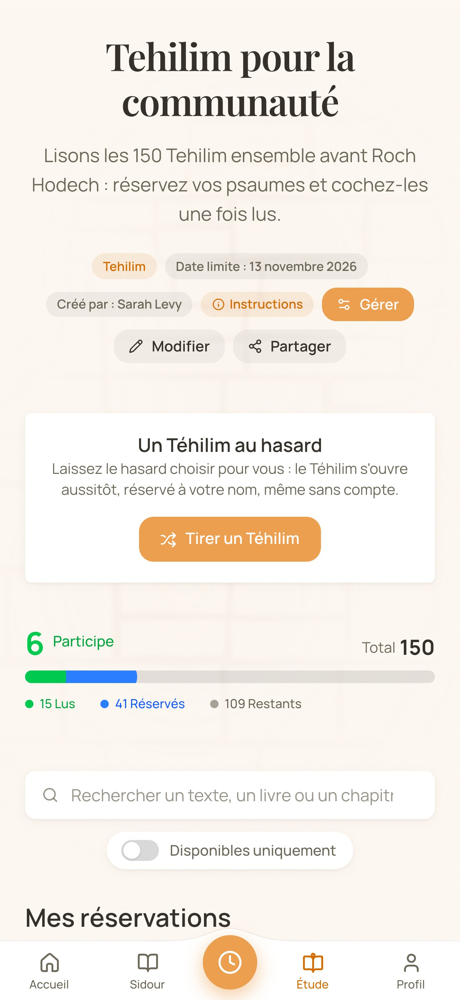
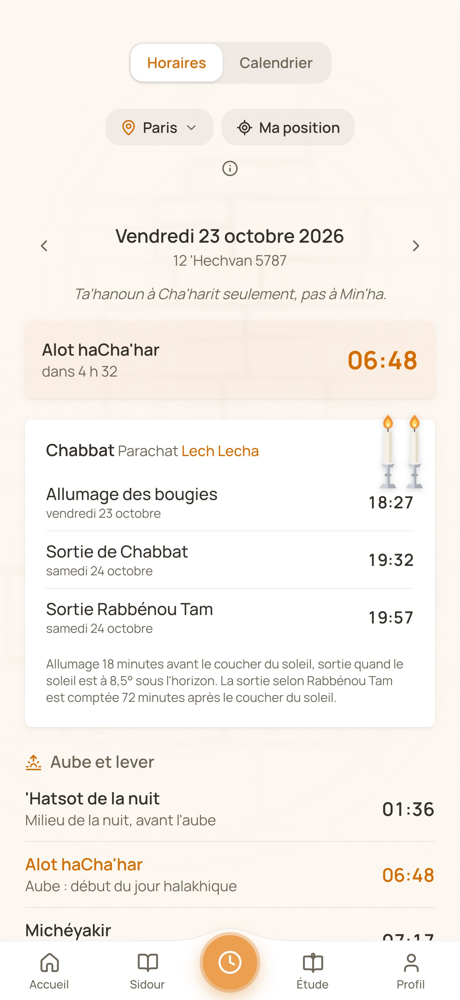
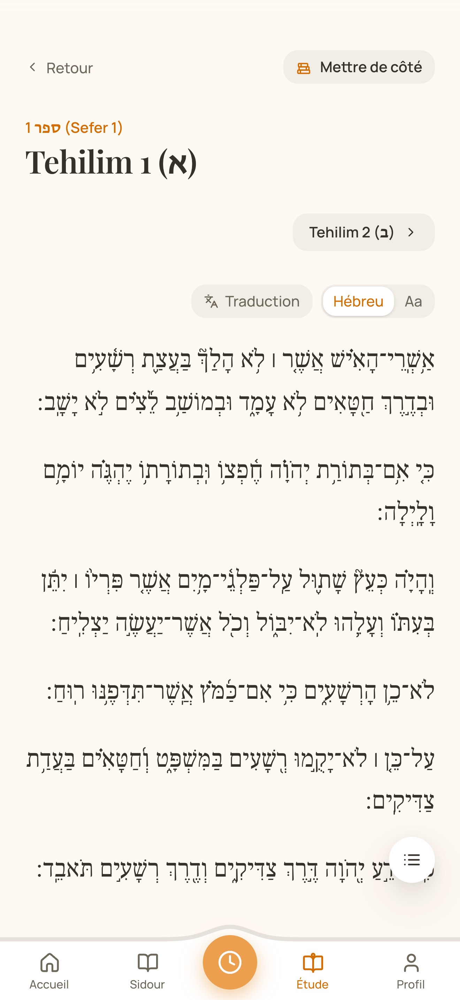
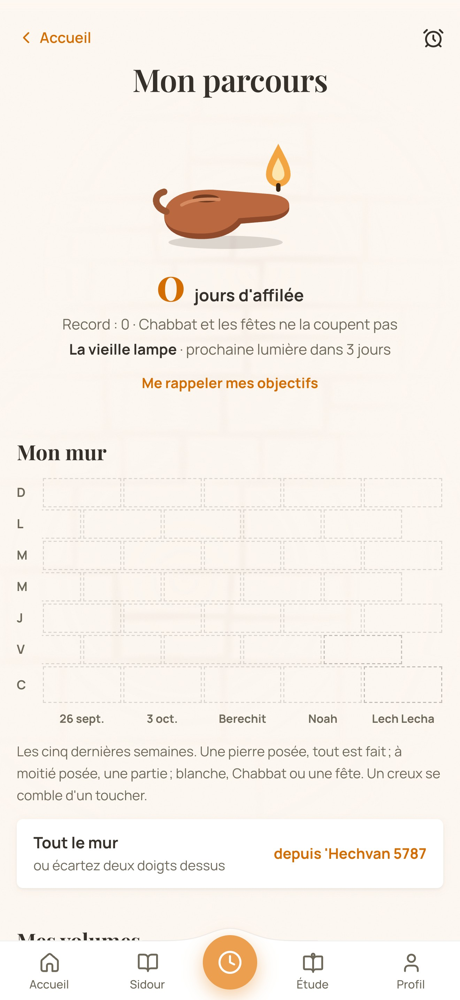
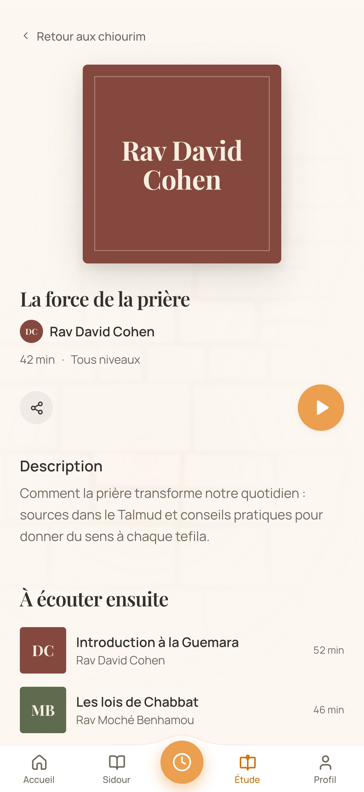
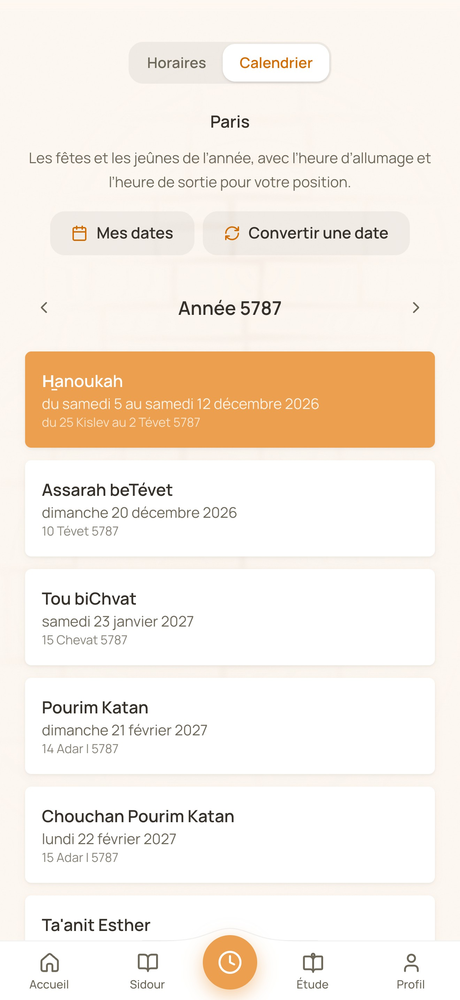

# Petite Jérusalem

**Study and share Torah, on your own or together.** Petite Jérusalem is a free,
ad-free web and mobile app for the Jewish community: a Torah library built for
Hebrew text and its translation, shared reading sessions to split a study
between many people, daily prayer times, a Jewish calendar and audio lessons.
It is available in French, English and Hebrew.

- Website: [petite-jerusalem.fr](https://petite-jerusalem.fr)
- Android: [Google Play](https://play.google.com/store/apps/details?id=fr.petitejerusalem.app)
- iOS: [App Store](https://apps.apple.com/app/id6798778029)

<p align="center">
  
  
  
  
</p>

> The screenshots show the French interface; the app also runs in English and
> in Hebrew (right to left). They are the store listing screenshots,
> generated by `npm run store:screenshots`.

## What it does

### A Torah library

Tehilim, Mishnah, Talmud, Tanakh, the Siddur (weekday prayers), holiday
texts (Moadim) and blessings (Brahot), with a reader made for Hebrew: verse
by verse, with a free translation alongside when one exists, adjustable text
size, and search across every text. **Download everything** once and the
whole library reads offline, on a plane or off the grid. The texts come from
the public [Sefaria](https://www.sefaria.org/) export.

### Shared reading sessions

The heart of the project. Someone creates a session (finish the Talmud
together by sharing out the tractates, read all 150 Tehilim for a refuah
shelemah or in memory of a loved one), shares a link, and everyone **reserves
the parts they will read**, then checks them off once read. A progress bar
follows the session all the way to the siyum. Joining needs no account; a
participant can even let chance pick a Tehilim for them.

The **perpetual chain** of Tehilim goes one step further: a chain that is
always open, that everyone moves forward, and that starts over from the first
psalm as soon as the last one is read. Nobody creates it; people entrust a
name to it.

**Nichmat 40** follows a custom of its own: forty people each say Nichmat
kol 'hai every day for forty days. Each takes a place and ticks their days;
the forty days begin on a chosen day, or once the forty places are taken.

### Daily reading and "My journey"

Pick the texts you want to read every day (a few Tehilim, a chapter of
Mishnah, the weekly portion) and the app tracks them, with a **reminder
notification** at the time you choose. "My journey" (Mon parcours) turns
goals into a wall that builds up stone by stone: finish a text by a date,
keep a habit, read the Tehilim of the month.

### Prayer times and calendar

Halachic times (zmanim) for your city or your position: dawn, the latest time
for the Shema and the Amidah, Min'ha, candle lighting, nightfall, with the
Hebrew date, the weekly portion and whether Tachanun is said. A calendar
shows holidays and fasts.

### Chiourim

A selection of audio lessons (shiurim) to listen to, published by their
authors from a dedicated studio space.

### On the phone, beyond the app

The native apps (Android and iOS, built with Capacitor) add **home screen
widgets** (prayer times, daily reading and shortcuts), **watch apps** (Wear
OS and Apple Watch: times, daily reading, Tehilim readable without the
phone), push notifications and app links (a link to the website opens the
installed app).

### Talking with users

The team posts announcements (what's new, an ongoing incident, a question or
a poll) that show up instantly on the home screen, and users can write to the
team from the app or the site and read the replies in a small messaging page.

<p align="center">
  
  
  
  
</p>

## How it is built

| Layer | Technology |
| --- | --- |
| Front end | [Vue 3](https://vuejs.org/) (Composition API, `<script setup>`) and [TypeScript](https://www.typescriptlang.org/), built with [Vite](https://vitejs.dev/) |
| Styles | [TailwindCSS](https://tailwindcss.com/), three themes described in [docs/design.md](docs/design.md) |
| Back end | [Firebase](https://firebase.google.com/): Auth, Firestore, Storage, Cloud Functions (`functions/`) |
| Mobile | [Capacitor](https://capacitorjs.com/) for Android and iOS; native widgets and watch apps in Kotlin and Swift (`native/`) |
| Languages | French, English, Hebrew (`src/locales/`) |
| Search engines | Static prerender of every public page, sitemaps, IndexNow (see [SEO.md](SEO.md)) |
| Analytics | [PostHog](https://posthog.com/), only with consent (see [docs/tracking-plan.md](docs/tracking-plan.md)) |
| Tests | [Vitest](https://vitest.dev/) (unit) and [Playwright](https://playwright.dev/) (end to end) |

### Repository layout

| Path | Contents |
| --- | --- |
| `src/` | The Vue app: views, components, services, locales, Firebase clients. |
| `functions/` | Cloud Functions: notifications, reminders, moderation, perpetual chain, support. |
| `public/texts/` | The text corpus (imported from Sefaria) and the prayers written here (`tefila/`). |
| `native/` | Native code added to the Capacitor projects: widgets, Wear OS and watchOS apps. |
| `scripts/` | Build, text generation, store publishing and the command line back office (`admin.mjs`). |
| `e2e/` | Playwright end to end suite. |
| `docs/` | Design, tests, CI/CD, tracking plan, feature notes and audits. |
| `store-assets/` | Play Store and App Store listings and screenshots. |

## Getting started

### Prerequisites

- **Node**: version 22 is recommended, it is the one pinned by `.nvmrc`
  (`nvm use`). The minimum accepted by `package.json` is 20.19 (`^20.19.0 ||
  >=22.12.0`), and `scripts/emulators.mjs` refuses to start under Node 20,
  the minimum version of the Firebase CLI.
- **Java (JDK 21 or later)**, required by the Firestore emulator
  (`java -version`). On macOS, `npm run emulators` picks an installed JDK 21+
  on its own if `JAVA_HOME` or the `PATH` points to an older version (a
  pinned `openjdk@11`, for instance).
- **Firebase CLI**:
  ```bash
  npm install -g firebase-tools
  ```

### Run the project locally

1. **Clone the repository**

   ```bash
   git clone git@github.com:Phenixel/PetiteJerusalem.git
   cd PetiteJerusalem
   ```

2. **Install the dependencies**

   ```bash
   npm install
   ```

3. **Start the dev server with the emulators**

   ```bash
   npm run dev:local
   ```

   This runs the Vite server and the Firebase emulators side by side (see the
   next section). `npm run dev` alone only starts Vite: the app then looks
   for emulators that are not running, and both sign-in and session creation
   fail.

4. **Check the code** (type-check, lint and Vitest unit tests)

   ```bash
   npm run verify
   ```

5. **Format the code** (Prettier, on `src/` only)

   ```bash
   npm run format
   ```

### Firebase locally (emulators)

In development (`import.meta.env.DEV`), the app automatically connects to four
Firebase emulators: **Auth** (`src/firebase/core.ts`), **Firestore**
(`src/firebase/firestore.ts`), **Storage** (`src/firebase/storage.ts`) and
**Functions** (`src/firebase/functions.ts`). You can sign up, sign in and
create sessions entirely offline, without access to the cloud project.

Once `npm run dev:local` is running:

- App: http://localhost:5473
- Emulator UI (Firestore data, Auth accounts): http://localhost:8473
- Auth emulator: `localhost:8471`; Firestore emulator: `localhost:8470`

> The project uses a **dedicated port range** (`5473` for Vite, from `8470` to
> `8477` for the emulators: Firestore 8470 and its websocket 8475, Auth 8471,
> Storage 8472, UI 8473, hub 8474, logging 8476, Functions 8477) instead of
> the Firebase and Vite defaults, so it can run next to other Firebase
> projects without conflict. The ports live in `firebase.json` (`emulators`
> block) and in `src/firebase/*.ts` (client side `connect*Emulator` calls):
> keep both in sync. On startup the emulator script also reclaims any orphan
> emulator still holding one of these ports, and on shutdown it stops the
> emulators cleanly so none is left behind.

**Create a first session locally**

1. Open the app, go to **Sign in, then Sign up**, and create an account with
   any email and password (the Auth emulator accepts anything, no real email
   is needed).
2. Once signed in, create a session as usual.

Data created in the emulators is **persisted** in `./.emulator-data` on
shutdown (`Ctrl+C`) and imported again on the next start: test sessions
survive restarts. The emulators can also run alone with `npm run emulators`.

## npm scripts

All of them are declared in `package.json`.

| Script | Purpose |
| --- | --- |
| `npm run dev` | Vite dev server (port 5473), connected to the emulators. |
| `npm run dev:local` | `emulators` and `dev` in parallel: the everyday command. |
| `npm run emulators` | The Firebase emulators alone, persisted in `./.emulator-data` (`scripts/emulators.mjs`). |
| `npm run build` | Full site build: `type-check`, `texts-manifest`, `build-only`, `prerender`, `well-known`. |
| `npm run build-only` | `vite build` alone, without type-check or prerender. |
| `npm run texts-manifest` | Writes `public/texts/manifest.json`, the fingerprint of each text file (`scripts/texts-manifest.mjs`). |
| `npm run prerender` | SEO prerender: one static HTML page per route, the sitemaps, `app.html` and `llms-full.txt` in `dist/` (`scripts/prerender-seo.mjs`). |
| `npm run well-known` | Writes `dist/.well-known/` (Android App Links, iOS Universal Links) (`scripts/well-known.mjs`). |
| `npm run indexnow` | Submits the sitemap URLs to IndexNow after a deployment (`scripts/indexnow.mjs`). |
| `npm run admin` | Command line back office (`scripts/admin.mjs`, see [docs/backoffice-cli.md](docs/backoffice-cli.md)). |
| `npm run type-check` | `vue-tsc --build`. |
| `npm run lint` | `eslint . --fix`. |
| `npm run format` | `prettier --write src/`: only formats `src/`. |
| `npm run verify` | `type-check`, then `lint`, then `vitest run`: what CI runs on every PR. |
| `npm run test:unit` | Vitest unit tests (watch mode). |
| `npm run test:e2e` | Playwright end to end suite, with the Firebase emulators when possible (`scripts/e2e.mjs`). |
| `npm run test:e2e:public` | The same, limited to the `public` project (pages without Firebase). |
| `npm run app:build` | Native bundle build: `type-check`, `texts-manifest`, `build-only`, `app:prune`, `app:prune-spm`, `cap:sync`. |
| `npm run app:prune` | Removes from the native bundle what only makes sense on the web (`scripts/prune-native-bundle.mjs`). |
| `npm run app:prune-spm` | Removes the unused OAuth providers from the iOS authentication plugin (`scripts/prune-spm-providers.mjs`). |
| `npm run cap:sync` | `cap sync`: pushes the web bundle and plugins to `android/` and `ios/`. |
| `npm run cap:android` | `app:build`, then opens Android Studio. |
| `npm run cap:ios` | `app:build`, then opens Xcode (macOS). |
| `npm run store:screenshots` | Play Store and App Store listing screenshots (`scripts/store-screenshots.mjs`). |

## Generation scripts

The `scripts/*.mjs` scripts that have no npm command run with
`node scripts/<name>.mjs`. Each one starts with a header that details its role.

| Script | Purpose |
| --- | --- |
| `build-brahot.mjs` | Builds the blessings and the rites around them (`public/texts/tefila/*`) from the Siddur Edot HaMizrach of the public Sefaria export. |
| `build-sidour.mjs` | Builds the weekday siddur texts (Cha'harit, Min'ha, Arvit) from the same Siddur, in the tefila file format. |
| `download-texts.mjs` | Downloads every referenced text from the public Sefaria export (GCS) to `public/texts/`. |
| `download-translations.mjs` | Downloads the selected free translations ([docs/traductions.md](docs/traductions.md)) and aligns them with the Hebrew texts, in `public/texts/traductions/`. |
| `generate-cities.mjs` | Regenerates `src/datas/cities.json`, the city list of the prayer times picker, with geonames coordinates. |
| `generate-hiloulot.mjs` | Regenerates `src/datas/hiloulot.json` and `hiloulot.he.json`, the hiloulot of the great rabbis day by day, from the Rabbi Ovadiah Yosef calendar (MIT). |
| `generate-talmud-chapters.mjs` | Generates `public/texts/talmud-chapters.json` by finding chapter boundaries in the raw Talmud text (Sefaria). |
| `generate-torah-weekday.mjs` | Writes `src/datas/torahWeekday.json`, the Monday and Thursday morning Torah reading, portion by portion. |
| `texts-manifest.mjs` | Writes `public/texts/manifest.json`; `--check` fails if the manifest no longer matches the files. |
| `release-notes.mjs` | Release notes ("What's new") shared by both stores: the GitHub release body, otherwise the default sentence. |
| `asc-auth-check.mjs` | App Store Connect authentication probe: signs a JWT with the ASC secrets and calls the API, for a clear diagnostic in CI. |
| `prune-spm-providers.mjs` | Removes from `@capacitor-firebase/authentication` the OAuth providers the app does not offer (the Facebook SDK, ~15 MB on iOS). |
| `emulators.mjs` | Starts the Firebase emulators with data persisted in `./.emulator-data`. |
| `e2e.mjs` | Runs the Playwright suite, reusing or starting the Auth and Firestore emulators. |

The publishing scripts (`setup-android.mjs`, `setup-ios.mjs`,
`play-listing.mjs`, `appstore-listing.mjs`, `asc-submit.mjs`,
`asc-screenshots.mjs`, `ios-signing.mjs`, `prepare-whatsnew.mjs`) are described
in [docs/android-ci-cd.md](docs/android-ci-cd.md) and
[docs/ios-ci-cd.md](docs/ios-ci-cd.md).

## Tests

The unit tests (Vitest) and the end to end suite (Playwright) are described in
[docs/tests.md](docs/tests.md), along with the list of guard tests that make CI
fail for reasons that are not obvious from the diff (a long dash, a missing
non-breaking space in French, a missing i18n key, a heavy module in the
initial bundle...).

## Documentation

| Document | Contents |
| --- | --- |
| [CLAUDE.md](CLAUDE.md) | Repository conventions: language (English), commit messages (Conventional Commits), typography, design, back office. |
| [CONTRIBUTING.md](CONTRIBUTING.md) | How to report a bug, suggest an improvement, open a pull request. |
| [SEO.md](SEO.md) | How the site is made findable by search engines and AI assistants: prerender, sitemaps, IndexNow, weekly refresh. |
| [docs/design.md](docs/design.md) | Visual guidelines: colors and themes, radii, fonts, navigation bar, what is not used. |
| [docs/tests.md](docs/tests.md) | Unit tests, guard tests, Playwright end to end suite. |
| [docs/tracking-plan.md](docs/tracking-plan.md) | PostHog tracking plan: events, properties, consent. |
| [docs/compatibilite-textes.md](docs/compatibilite-textes.md) | Served texts are read by older apps: how to write a condition without making a passage disappear. |
| [docs/traductions.md](docs/traductions.md) | The free translations shipped with the texts. |
| [docs/parcours.md](docs/parcours.md) | "My journey": goals, habits and the daily reading. |
| [docs/chaine-perpetuelle.md](docs/chaine-perpetuelle.md) | The perpetual Tehilim chain. |
| [docs/nichmat-40-jours.md](docs/nichmat-40-jours.md) | Nichmat 40: forty readers, forty days. |
| [docs/informations.md](docs/informations.md) | Team announcements: what's new, incidents, questions and polls. |
| [docs/feedback.md](docs/feedback.md) | "Write to us": user messages and the team's replies. |
| [docs/moderation.md](docs/moderation.md) | Session moderation (App Store requirements, guideline 1.2). |
| [docs/backoffice-cli.md](docs/backoffice-cli.md) | The command line back office (`scripts/admin.mjs`). |
| [docs/app-native.md](docs/app-native.md) | Capacitor native app: generate, build, test; offline reading, native auth, push, widgets. |
| [docs/app-links.md](docs/app-links.md) | App links: a link to the site opens the installed app (`/.well-known/`). |
| [docs/app-widgets.md](docs/app-widgets.md) | Home screen widgets (Android / iOS): prayer times, daily reading and their shortcuts. |
| [docs/app-watch.md](docs/app-watch.md) | Watches (Wear OS / Apple Watch): prayer times, daily reading, Tehilim. |
| [docs/staging.md](docs/staging.md) | The staging environment. |
| [docs/android-ci-cd.md](docs/android-ci-cd.md) | Android CI/CD: automatic Play Store release on every `vX.Y.Z` tag. |
| [docs/ios-ci-cd.md](docs/ios-ci-cd.md) | iOS CI/CD: automatic TestFlight upload on every `vX.Y.Z` tag. |
| [docs/firebase-ci-cd.md](docs/firebase-ci-cd.md) | Firebase CI/CD: what `deploy.yml` deploys and the service account permissions. |
| [docs/notes-de-version.md](docs/notes-de-version.md) | Writing the release notes of a tag: three languages, 500 characters per language, new features then fixes. |
| [docs/ios-release-plan.md](docs/ios-release-plan.md) | iOS release plan, from "no Apple account" to "app on sale". |
| [docs/audit-performance-2026-07.md](docs/audit-performance-2026-07.md) | July 2026 performance audit: slow site, HTML cache, fixes. |
| [docs/audit-review-2026-09.md](docs/audit-review-2026-09.md) | September 2026 code and optimization review: fixed, work items, product ideas. |
| [docs/audit-seo-2026-09.md](docs/audit-seo-2026-09.md) | September 2026 SEO audit: HTML served to crawlers, files for crawlers, manual actions. |

## Contributing

Contributions are welcome. [CONTRIBUTING.md](CONTRIBUTING.md) explains how to
contribute, and [CLAUDE.md](CLAUDE.md) lists the conventions every change
follows (English, Conventional Commits, typography).

## License

This project is released under the **Creative Commons
Attribution-NonCommercial 4.0 International (CC BY-NC 4.0)** license. Using
this code for commercial purposes is **forbidden**. See the
[LICENSE](LICENSE) file.
